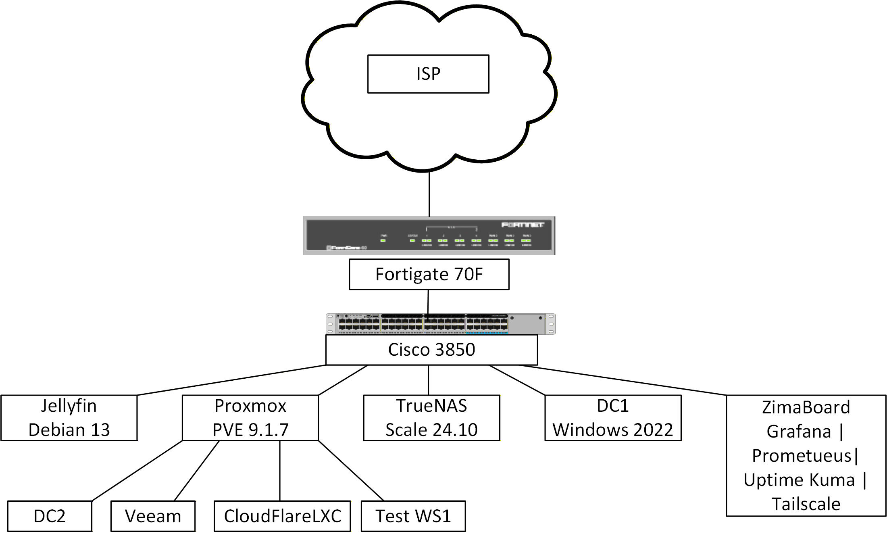

# HuntWired Homelab | Infrastructure & Security Engineering

A self-hosted infrastructure environment designed to develop and demonstrate practical experience in **network engineering, systems administration, cybersecurity, virtualization, and infrastructure operations**.

This repository documents the architecture, implementation, administration, and troubleshooting of an enterprise-inspired homelab built using physical servers, virtualization, network segmentation, security controls, and centralized monitoring.

The environment is actively maintained and expanded to support technical learning, experimentation, and professional development.

---

## High-Level Architecture

*Architecture note: This diagram represents a simplified snapshot of the homelab infrastructure. It illustrates the core network architecture and major systems rather than an exhaustive, continuously updated inventory. Individual services, software versions, and workloads may change as the environment evolves. Refer to the infrastructure documentation for more detailed and current information.*

## Infrastructure at a Glance

| Technology | Implementation |
|---|---|
| Networking | Cisco Catalyst 3850, Layer 3 routing, VLAN segmentation, ACLs |
| Perimeter Security | Fortinet FortiGate |
| Virtualization | Proxmox VE |
| Storage | TrueNAS SCALE, ZFS, iSCSI, SMB, NFS |
| Identity Services | Windows Server Active Directory, DNS, Group Policy |
| Backup & Recovery | Veeam Backup & Replication |
| Monitoring | Prometheus, Grafana, Uptime Kuma |
| Remote Access | Tailscale, Cloudflare Tunnel, AnyDesk |
| Linux Administration | Debian, Ubuntu Server |
| Media Infrastructure | Dedicated bare-metal Jellyfin server |
| Network Simulation | GNS3 with virtual networking appliances |
| Automation | Ansible in Docker — development in progress |
| Security Monitoring | Splunk Enterprise — log ingestion pending |

---

## Architecture Overview

The homelab uses a layered network architecture with dedicated segments for infrastructure, management, storage, media services, endpoints, and security testing.

### Networking and Security

A Fortinet FortiGate provides perimeter security and external connectivity.

The Cisco Catalyst 3850 core switch performs internal Layer 3 routing and enforces inter-VLAN access restrictions through access control lists (ACLs).

This architecture separates management and infrastructure resources from general-purpose endpoints and other workloads.

### Compute and Virtualization

Proxmox VE hosts Windows and Linux infrastructure services, including Active Directory, backup infrastructure, and network simulation workloads.

Dedicated physical servers provide storage and media services independently of the primary virtualization environment.

### Storage and Data Protection

TrueNAS SCALE provides centralized storage using ZFS and multiple storage protocols.

Veeam Backup & Replication provides scheduled backups for supported virtual infrastructure, with recovery testing that includes full virtual machine restoration and file-level recovery.

### Monitoring and Operations

A dedicated ZimaBoard hosts Docker-based monitoring services, including Prometheus, Grafana, and Uptime Kuma.

These services provide performance metrics, dashboards, and service availability monitoring.

### Remote Administration

Remote administration uses Tailscale subnet routing, Cloudflare Tunnel application publishing, and AnyDesk access to a management workstation.

Cisco ACLs restrict administrative connectivity between network segments.

---

## Infrastructure Documentation

Each section documents deployed systems, architectural decisions, administration, and troubleshooting.

| Section | Description |
|---|---|
| [Networking](Infrastructure/Networking.md) | Cisco switching, routing, VLANs, ACLs, and segmentation |
| [Virtualization](Infrastructure/Virtualization.md) | Proxmox infrastructure and virtualized workloads |
| [Storage](Infrastructure/Storage.md) | TrueNAS SCALE, ZFS, storage protocols, and capacity management |
| [Active Directory](Infrastructure/Active-Directory.md) | Windows Server identity services, DNS, and Group Policy |
| [Backups](Infrastructure/Backups.md) | Veeam backup architecture, scheduling, retention, and recovery testing |
| [Monitoring](Infrastructure/Monitoring.md) | Prometheus, Grafana, exporters, and Uptime Kuma |
| [Remote Access](Infrastructure/Remote-Access.md) | Tailscale, Cloudflare Tunnel, AnyDesk, and administrative access |
| [Media Server](Infrastructure/Media-Server.md) | Debian, Jellyfin, storage, user management, and monitoring |
| [Automation / Ansible](Infrastructure/Automation/Ansible/README.md) | Ansible deployment, existing playbooks, and planned automation development |

---

## Security Engineering Approach

Security is incorporated throughout the infrastructure rather than treated as a standalone component.

Key areas include:

- Network segmentation and restrictive inter-VLAN ACLs
- Separation of management and application workloads
- Controlled remote administrative access
- Active Directory identity and access management
- Backup and recovery validation
- Infrastructure monitoring and troubleshooting
- Isolated environments for network and security experimentation
- Defensive infrastructure design and evaluation

The homelab also supports the development of offensive security skills through controlled testing and network simulation.

---

## Skills Demonstrated

**Network Engineering:** Cisco switching, VLAN architecture, inter-VLAN routing, access control, troubleshooting, and Fortinet firewall administration.

**Systems Engineering:** Windows Server, Linux, Active Directory, virtualization, storage infrastructure, and service deployment.

**Infrastructure Reliability:** Backup scheduling, recovery testing, monitoring, performance troubleshooting, and capacity planning.

**Cybersecurity Engineering:** Network isolation, access restrictions, remote administration, security testing, and defensive infrastructure design.

**Automation and Tooling:** Docker, Ansible, monitoring integrations, and developing repeatable administration workflows.

---

## Current Development

The environment continues to evolve through practical projects and ongoing technical development.

Current and planned areas include:

- Expanding GNS3 network simulation and security testing
- Configuring Splunk Enterprise log ingestion and security monitoring
- Rebuilding and validating Ansible automation
- Improving operational monitoring and alerting
- Developing additional network and cybersecurity engineering projects

Projects under development are documented according to their verified implementation status.

---

## Documentation and Security

This repository demonstrates technical architecture and engineering decisions without intentionally exposing unnecessary details about the live environment.

Public documentation omits credentials, private network addressing, externally accessible service hostnames, and sensitive configuration details.

Configuration examples and architectural descriptions are provided for educational and portfolio purposes.

---

## Purpose

This homelab supports continuous professional development in infrastructure engineering, network security, and penetration testing.

Its primary purpose is to translate technical knowledge into practical experience through deployment, administration, troubleshooting, security evaluation, and technical documentation.
